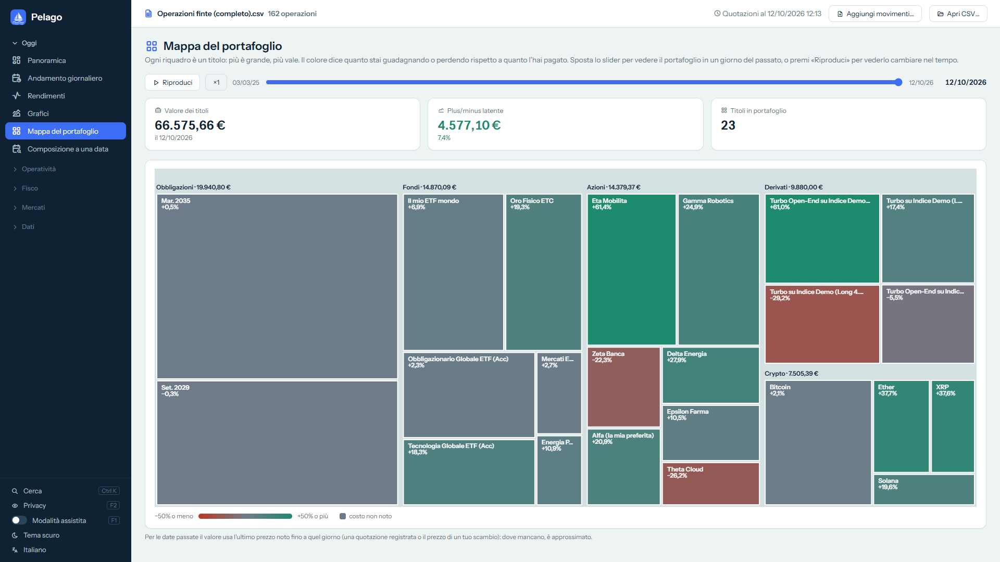

# Pelago

**[Versione italiana → README.md](README.md)**

Pelago is a Windows app that turns the transactions CSV exported from Trade Republic into what the file alone doesn't tell you: **how your portfolio changed over time**. One tile per holding (bigger = worth more, green/red = gain/loss on cost), a slider to go back to any day in the past, and a "Play" button to watch it change.

Free, ad-free, non-profit, free software (GPL-3.0). The interface is available in Italian, English, French, German and Spanish.

> **Personal, unofficial project.** Pelago is not affiliated with or endorsed by Trade Republic and has no access to your account. It is not financial or tax advice: all values are estimates computed from the file.



## What it does

- **Portfolio map** with a time slider and "Play": holdings appear, grow and disappear.
- **Overview**, **daily trend**, **returns** (time-weighted and annualized on deposits), monthly composition **charts**.
- **Composition on a date**, open and closed **positions**, **capital gains**, trade **statistics**, **tax backpack** (Italian tax logic), **BTP** calculator.
- **Assisted mode**: hover a column or a number to see what it is and how it is computed.
- Light and dark themes. Your CSV is **never modified**; one-click local backup.

The screenshots use a sample account with **invented data** (see [samples/](samples/)). Some screens and texts in the screenshots are in Italian.

## Privacy: what leaves your PC

The CSV and your data stay on your PC (folder `%LOCALAPPDATA%\Pelago`). Pelago **never asks for a login or password** and never connects to your account.

To get prices, the app calls public services and **sends only instrument codes and dates — never personal data, amounts or quantities**:

| Service | Used for |
|---|---|
| `query1/query2.finance.yahoo.com` (Yahoo Finance) | stock and fund prices, FX rates |
| `api.coingecko.com` (CoinGecko) | crypto prices |
| `api.frankfurter.dev` (ECB data) | reference FX rates and history |
| `borsaitaliana.it` | Italian government bond (BTP) list, prices and names: a single request, and only if the account holds BTPs (also with "Update all" and on startup) |
| `data-api.ecb.europa.eu` (ECB), `api.statistiken.bundesbank.de` (Bundesbank), `home.treasury.gov` and `treasurydirect.gov` (US Treasury) | yield curves |
| `markets.vontobel.com` | price and name of Vontobel derivatives — **off by default**, enabled from the Quotes page |
| `prodotti.societegenerale.it` | price and name of Société Générale derivatives — **off by default**, enabled from the Quotes page with a banner quoting the site's legal notice |

The code is public, so you can check there is nothing else (search for `http` in `Services/`).

## How to use it

1. Download the transactions CSV from your Trade Republic account.
2. Download `pelago.exe` from the [**Releases**](https://github.com/pelago-claude/pelago/releases) page of this repository and run it (64-bit Windows 10/11; it needs the *WebView2 Runtime*, already included in Windows 11 and in most up-to-date Windows 10).
3. Click **Open CSV** and choose the file.

**Want to try it without your own data?** On the Overview, with no file loaded, press **Try an example account**: a second window opens with an **invented** account (about 160 transactions between March 2025 and October 2026 — stocks, funds, bonds, derivatives and crypto), ideal for trying the portfolio map and the time slider. It lives in a separate temporary folder: it never touches your data, and once you close the window nothing is left. If you prefer, download the [sample CSV](https://raw.githubusercontent.com/pelago-claude/pelago/main/samples/esempio-operazioni.csv) (right-click → *Save link as*; it is also attached to every release) and open it with **Open CSV**.

Every release lists the **SHA-256** of `pelago.exe`: compare it with `Get-FileHash pelago.exe`. The executable is not code-signed, so Windows may show a SmartScreen warning the first time. If you prefer not to trust a downloaded file, build it yourself (below).

> If something is wrong with your file, **never attach your real CSV** to a report: it contains all your transactions. Describe the problem, or start from `samples/esempio-operazioni.csv`.

## Data on your PC and how to uninstall

Pelago is a **single portable file**: there is no installer, it does not write to the Windows registry and it does not start with your computer. To remove it, just delete `pelago.exe`.

What it stores on your PC:

- `%LOCALAPPDATA%\Pelago`: preferences, downloaded quotes, the instrument names you choose, the copy of the transactions archive and the `webview2` folder of the embedded browser. To wipe everything, delete this folder.
- An **automatic backup** (unless you turn it off in *Data and files*): a compressed copy of your data every 7 days, keeping the last 8, in `Documents\Pelago backup`. In *Data and files* you can change the folder or switch it off.
- The **price update on startup** (when prices are older than 12 hours) can be switched off on the *Quotes* page.

Your CSV files are never modified.

## Building from source

You need Windows and the .NET 8 SDK.

```bash
dotnet test Tests/Pelago.Tests.csproj
dotnet publish Pelago.csproj -c Release -r win-x64 --self-contained true -p:PublishSingleFile=true -p:IncludeNativeLibrariesForSelfExtract=true -p:EnableCompressionInSingleFile=true -o publish/win-x64
```

The result is `publish/win-x64/pelago.exe`. The app is written in C# (.NET 8, Windows Forms with a Blazor UI inside WebView2); charts use [Apache ECharts](https://echarts.apache.org). Source strings are in Italian, translations live in `i18n/`.

## Feedback

Bug reports and suggestions are welcome: open an [*Issue*](https://github.com/pelago-claude/pelago/issues/new/choose), or write to **pelago_claude@gmail.com** (without attaching your CSV). I'm especially interested in **what you need most, what is unclear, what is missing**. See also [CONTRIBUTING.md](CONTRIBUTING.md).

## Warnings and liability

Pelago calculates values, returns and tax summaries from the CSV file you give it, using simplified formulas: **they are estimates**, may contain errors or fail to account for every case. They are not an official balance, nor financial, legal or tax advice, and they do not replace your broker's official documents or a professional. **Always check the numbers before using them, in particular for your tax return: you are responsible for what you declare.**

At every start, the first time you open the tax section (Tax backpack, Costs and taxes, Coupons and maturities), Pelago shows a window with these warnings and asks for a "Got it"; it does not remember the choice, and shows up again the next time you start the program. The Excel files of the tax summaries and of the capital gains carry the warning at the bottom.

Pelago is provided "as is", without warranties of any kind (GPL-3.0, sections 15-16): to the extent permitted by law, the author is not liable for any damage arising from the use of the program or its results.

### Known limits of the tax backpack

- Not handled: **IVAFE** and **form RW** (only the year-end value is shown), **taxes paid abroad** and the **tax regime** chosen.
- Other corporate actions, such as splits and spin-offs, may not be treated correctly.
- The broker's file does not say whether a "fund" is an ETF or an ETC/ETN: Pelago tries to guess from the name, and the classification must be checked (it can be corrected).
- Tax rates, thresholds and exemptions are not calculated: the summary shows amounts, not the tax due.

## License

Copyright © 2026 David. Pelago is free software, distributed under the terms of the **GNU General Public License version 3** ([LICENSE](LICENSE)), **without any warranty**. Bundled third-party libraries keep their own licenses: see [THIRD-PARTY-NOTICES.md](THIRD-PARTY-NOTICES.md).

"Trade Republic" is a trademark of its respective owners, mentioned only to describe the file format Pelago reads.
