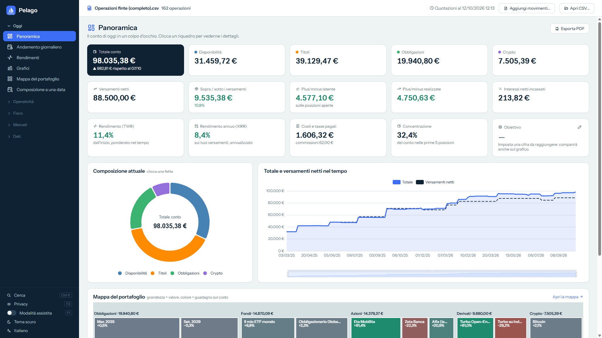
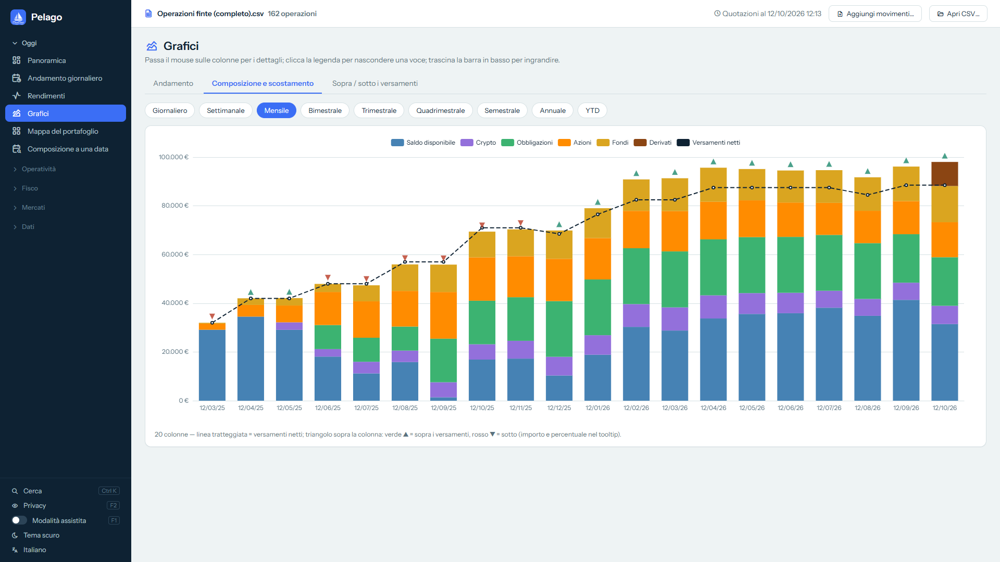

# Pelago

**[English version → README.en.md](README.en.md)**

Pelago è un'app per Windows che trasforma il file CSV delle transazioni di Trade Republic in quello che il file da solo non dice: **come è cambiato il tuo portafoglio nel tempo**. Un riquadro per ogni titolo (più grande = vale di più, verde/rosso = guadagno/perdita sul costo), uno slider per tornare a qualsiasi giorno del passato e un pulsante «Riproduci» per vederlo cambiare.

Gratis, senza pubblicità, senza scopo di lucro, software libero (GPL-3.0).

> **Progetto personale e non ufficiale.** Pelago non è affiliato a Trade Republic, non è approvato da Trade Republic e non ha alcun accesso al tuo conto. Non è consulenza finanziaria né fiscale: i valori sono stime calcolate dal file.


## Che cosa fa

- **Mappa del portafoglio** con slider del tempo e «Riproduci»: i titoli compaiono, crescono, spariscono.
- **Panoramica** del conto, **andamento giornaliero**, **rendimenti** (ponderato nel tempo e annualizzato sui versamenti), **grafici** di composizione mese per mese.
- **Composizione a una data**, **posizioni aperte e chiuse**, **plusvalenze**, **statistiche** delle operazioni, **zainetto fiscale**, calcolatore dei **BTP**.
- **Modalità assistita**: passando il mouse su una colonna o un numero spiega che cos'è e come è calcolato.
- Cinque lingue: italiano, inglese, francese, tedesco, spagnolo. Tema chiaro e scuro.
- Il tuo CSV **non viene mai modificato**. Backup locale in un clic.

|  |  |
|---|---|
|  |  |

Le schermate usano un conto di esempio con **dati inventati** (vedi [samples/](samples/)).

## Privacy: cosa esce dal tuo PC

Il CSV e i tuoi dati restano sul PC (cartella `%LOCALAPPDATA%\DPOper`). Pelago **non chiede mai login o password** e non si collega al conto.

Per i prezzi l'app fa richieste a servizi pubblici e **invia solo codici di titoli e date, mai dati personali, importi o quantità**:

| Servizio | A che cosa serve |
|---|---|
| `query1/query2.finance.yahoo.com` (Yahoo Finance) | prezzi di azioni e fondi, cambi |
| `api.coingecko.com` (CoinGecko) | prezzi delle crypto |
| `api.frankfurter.dev` (dati BCE) | cambi di riferimento e storico |
| `borsaitaliana.it` | elenco e prezzi dei BTP |
| `data-api.ecb.europa.eu` (BCE), `api.statistiken.bundesbank.de` (Bundesbank), `home.treasury.gov` e `treasurydirect.gov` (Tesoro USA) | curve dei rendimenti |
| `markets.vontobel.com` | prezzo e nome dei derivati Vontobel — **spento di default**, si attiva da Quotazioni |
| `prodotti.societegenerale.it` | prezzo e nome dei derivati Société Générale — **spento di default**, si attiva da Quotazioni con un banner che riporta le Note Legali del sito |

Il codice è pubblico: puoi verificare tu stesso che non ci sia altro (cerca `http` in `Services/`).

## Come si usa

1. Scarica il file CSV delle transazioni dal tuo account Trade Republic.
2. Scarica `pelago.exe` dalla pagina [**Releases**](https://github.com/pelago-claude/pelago/releases) di questo repository e avvialo (Windows 10/11 a 64 bit; serve il *WebView2 Runtime*, già presente in Windows 11 e nella maggior parte dei Windows 10 aggiornati).
3. Clicca **Apri CSV** e scegli il file.

**Vuoi provarla senza i tuoi dati?** Scarica il [CSV di esempio](https://raw.githubusercontent.com/pelago-claude/pelago/main/samples/esempio-operazioni.csv) (tasto destro → *Salva link con nome*; è anche tra i file di ogni release). È un conto **inventato** con circa 160 operazioni tra marzo 2025 e ottobre 2026: azioni, fondi, obbligazioni, derivati e crypto, ideale per provare la mappa del portafoglio e lo slider.

Ogni versione pubblicata riporta l'impronta **SHA-256** di `pelago.exe`: confrontala con `Get-FileHash pelago.exe`. L'eseguibile non è firmato digitalmente: la prima volta Windows può mostrare l'avviso SmartScreen («Windows ha protetto il PC»). Se preferisci non fidarti di un file scaricato, compilalo tu (sotto).

> Se qualcosa non torna con il tuo file, **non allegare mai il tuo CSV vero** a una segnalazione: contiene tutte le tue operazioni. Descrivi il problema, o parti da `samples/esempio-operazioni.csv`.

## Dati sul PC e come disinstallare

Pelago è un **singolo file portabile**: non ha un installatore, non scrive nel registro di Windows e non si avvia con il computer. Per rimuoverlo basta cancellare `pelago.exe`.

Quello che salva, sul tuo PC:

- `%LOCALAPPDATA%\DPOper`: preferenze, quotazioni scaricate, i nomi dei titoli che scegli, la copia dell'archivio delle operazioni e la cartella `webview2` del browser incorporato. Per cancellare tutto, elimina questa cartella.
- Un **backup automatico** (se non lo spegni in *Dati e file*): una copia compressa dei dati ogni 7 giorni, nelle ultime 8 versioni, in `Documenti\Pelago backup`. Da *Dati e file* puoi cambiare la cartella o disattivarlo.
- L'**aggiornamento dei prezzi all'apertura** (se i prezzi hanno più di 12 ore) si spegne dalla pagina *Quotazioni*.

I tuoi file CSV non vengono mai modificati.

## Compilare dal sorgente

Servono Windows e l'SDK .NET 8.

```bash
dotnet test Tests/Pelago.Tests.csproj
dotnet publish DPOper.csproj -c Release -r win-x64 --self-contained true -p:PublishSingleFile=true -p:IncludeNativeLibrariesForSelfExtract=true -p:EnableCompressionInSingleFile=true -o publish/win-x64
```

L'eseguibile finale è `publish/win-x64/pelago.exe`. L'app è in C# (.NET 8, Windows Forms con interfaccia Blazor in un WebView2); i grafici sono [Apache ECharts](https://echarts.apache.org). I testi sorgente sono in italiano, le traduzioni in `i18n/`.

## Segnalazioni e feedback

Le segnalazioni e i suggerimenti sono benvenuti: apri una [*Issue*](https://github.com/pelago-claude/pelago/issues/new/choose) di questo repository, oppure scrivi a **pelago_claude@gmail.com** (senza allegare il tuo CSV). Mi interessa soprattutto sapere **che cosa ti serve di più, che cosa non si capisce, che cosa manca**. Vedi anche [CONTRIBUTING.md](CONTRIBUTING.md).

## Licenza

Copyright © 2026 David. Pelago è software libero, distribuito secondo i termini della **GNU General Public License versione 3** ([LICENSE](LICENSE)), **senza alcuna garanzia**. Le librerie di terzi incluse mantengono le loro licenze: vedi [THIRD-PARTY-NOTICES.md](THIRD-PARTY-NOTICES.md).

«Trade Republic» è un marchio dei rispettivi titolari, citato solo per indicare il formato del file letto da Pelago.
